# AppChat — Bộ sơ đồ kiến trúc & WBS Thiết kế UI/UX

Tài liệu này trực quan hoá kiến trúc nền tảng **AppChat** từ tài liệu System Design Document (SDD) và hiện trạng sản phẩm. Toàn bộ sơ đồ được xuất ra ảnh **PNG** trong thư mục [`diagrams/`](diagrams/), sắp xếp theo **7 nhóm chủ đề**, kèm bản phân rã công việc thiết kế (**WBS**) có ước lượng effort và phân công vai trò.

- **14 sơ đồ** · 7 nhóm chủ đề
- **17 module** nghiệp vụ
- **WBS ~119 man-day**
- Bản xem trực quan đầy đủ: [`UIUX-Architecture.dc.html`](UIUX-Architecture.dc.html)

---

## Mục lục

| Nhóm | Nội dung | Sơ đồ |
|---|---|---|
| **W** | Work Breakdown Structure (Thiết kế UI/UX) | — |
| **A** | Kiến trúc tổng thể hệ thống | A1, A2 |
| **B** | Sitemap / Information Architecture | B1 |
| **C** | User Flow theo nghiệp vụ | C1–C5 |
| **D** | Sơ đồ phân rã chức năng | D1 |
| **E** | Design System & Component Hierarchy | E1, E2 |
| **F** | Sequence Diagram | F1, F2 |
| **G** | Data Model & Luồng dữ liệu | G1, G2 |

---

## W · Work Breakdown Structure — Thiết kế UI/UX

6 giai đoạn · ước lượng effort (man-day) & phân công vai trò.

| Mã | Hạng mục công việc | Sản phẩm bàn giao | Effort (md) | Phụ trách |
|---|---|---|:--:|---|
| **P0** | **Nghiên cứu & Khám phá** | | **12** | |
| 0.1 | Phỏng vấn stakeholder & thu thập yêu cầu | Biên bản, mục tiêu sản phẩm | 3 | UX Lead |
| 0.2 | Nghiên cứu người dùng & chân dung | Persona, JTBD (CSKH/Sales/MKT/QL) | 4 | UX Researcher |
| 0.3 | Phân tích đối thủ & audit SDD | Báo cáo benchmark | 2 | UX Lead |
| 0.4 | Bản đồ hành trình khách hàng & nghiệp vụ | Journey map | 3 | UX Researcher |
| **P1** | **Information Architecture & Flows** | | **18** | |
| 1.1 | Cây thông tin & điều hướng (17 module) | Sitemap | 3 | UX Lead |
| 1.2 | Luồng nghiệp vụ chính | User flows (login, kênh, ví, broadcast, inbox…) | 5 | UX Designer |
| 1.3 | Wireframe lo-fi toàn bộ màn hình | Wireframe | 8 | UX Designer |
| 1.4 | Kiểm thử concept lo-fi | Báo cáo test | 2 | UX Researcher |
| **P2** | **Design System / UI Kit** | | **16** | |
| 2.1 | Design tokens (màu, type, spacing, radius, shadow) | Token sheet | 3 | Design System Lead |
| 2.2 | Thư viện component (nav, card, table, form, modal, kanban…) | UI Kit | 8 | Design System Lead |
| 2.3 | Iconography & minh hoạ | Bộ icon | 3 | UI Designer |
| 2.4 | Mẫu layout & grid app-shell | Layout spec | 2 | Design System Lead |
| **P3** | **Thiết kế giao diện theo module** | | **51** | |
| 3.1 | App-shell, điều hướng, Tổng quan (Dashboard) | Hi-fi | 4 | UI Designer |
| 3.2 | Trợ lý AI (chat-command) | Hi-fi | 4 | UI Designer |
| 3.3 | Hộp thư omnichannel + Customer 360 | Hi-fi | 6 | UI Designer |
| 3.4 | Khách hàng / CDP (CRM, custom field) | Hi-fi | 5 | UI Designer |
| 3.5 | Marketing & Broadcast (Email/Zalo/SMS/Automation) | Hi-fi | 6 | UI Designer |
| 3.6 | Bán hàng: Báo giá, Đơn, Hợp đồng, Sản phẩm | Hi-fi | 6 | UI Designer |
| 3.7 | CSKH: Ticket & SLA | Hi-fi | 4 | UI Designer |
| 3.8 | Lịch hẹn, AI Agents, Quy trình | Hi-fi | 5 | UI Designer |
| 3.9 | Call Center & AI Voice | Hi-fi | 3 | UI Designer |
| 3.10 | Loyalty & Báo cáo | Hi-fi | 4 | UI Designer |
| 3.11 | Ví AppChat, Đối tác, Cài đặt | Hi-fi | 4 | UI Designer |
| **P4** | **Prototype & Kiểm thử** | | **12** | |
| 4.1 | Prototype tương tác (luồng chính) | Prototype | 5 | Prototyper |
| 4.2 | Usability testing & tổng hợp | Báo cáo | 3 | UX Researcher |
| 4.3 | Tinh chỉnh theo phản hồi | Bản cập nhật | 4 | UI Designer |
| **P5** | **Bàn giao & Hỗ trợ phát triển** | | **10** | |
| 5.1 | Spec & redline, design handoff | Tài liệu handoff | 3 | UI Designer |
| 5.2 | Hỗ trợ phát triển & QA giao diện | Ghi chú QA | 4 | UI Designer |
| 5.3 | Bộ sơ đồ kiến trúc & tài liệu hệ thống | Sơ đồ + index (tài liệu này) | 3 | UX Lead |
| | **TỔNG CỘNG** | | **119** | man-day |

---

## A · Kiến trúc tổng thể hệ thống

### A1 — Kiến trúc phân lớp tổng thể
Từ kênh khách hàng → API Gateway → dịch vụ lõi → lớp AI → lớp dữ liệu → tích hợp ngoài.

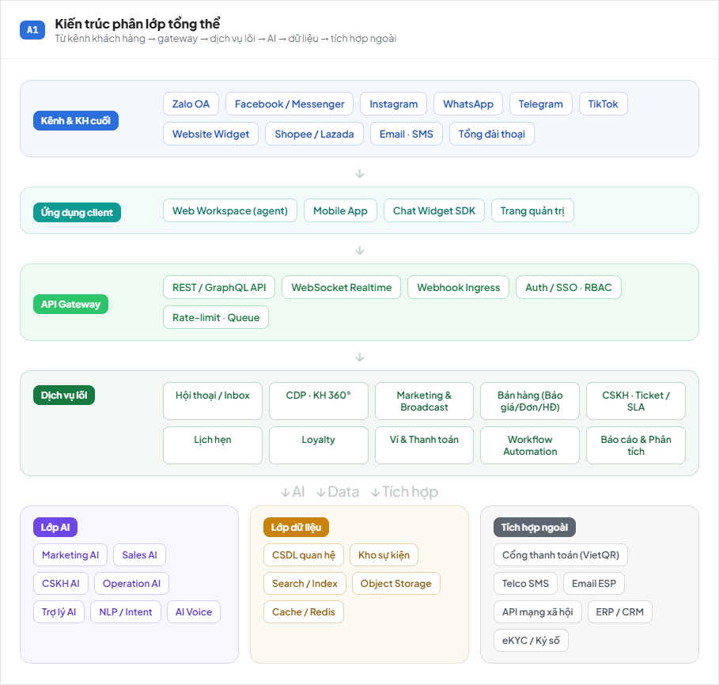

### A2 — Kiến trúc lớp AI Agents
Trợ lý điều phối (Orchestrator) → agent chuyên trách → năng lực dùng chung → hành động trên dịch vụ lõi, có cơ chế human-in-the-loop.

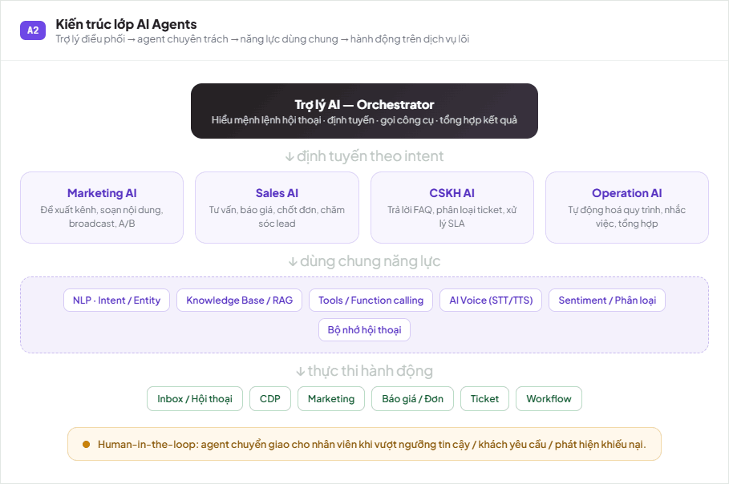

---

## B · Sitemap / Information Architecture

### B1 — Cây điều hướng Workspace
17 module, nhóm theo cụm chức năng trên thanh điều hướng trái.

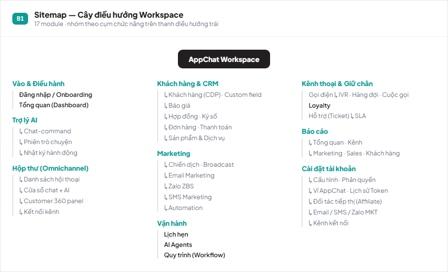

---

## C · User Flow theo nghiệp vụ

### C1 — Đăng nhập & Onboarding
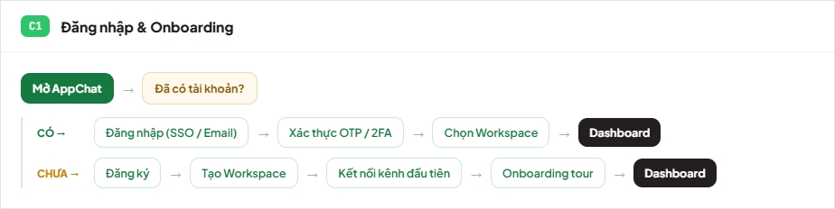

### C2 — Kết nối kênh (Zalo / Facebook / IG…)
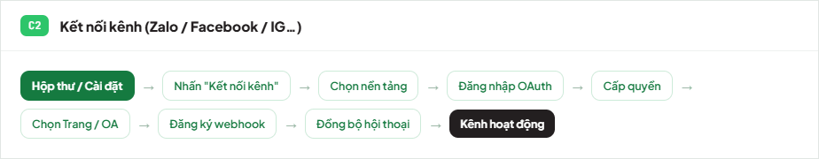

### C3 — Nạp ví & thanh toán QR
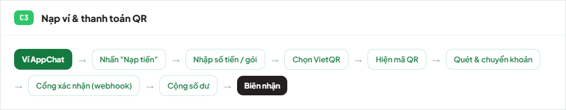

### C4 — Tạo chiến dịch Broadcast (Marketing)
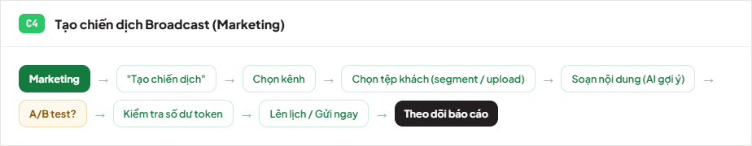

### C5 — Xử lý hội thoại Inbox (AI → nhân viên)
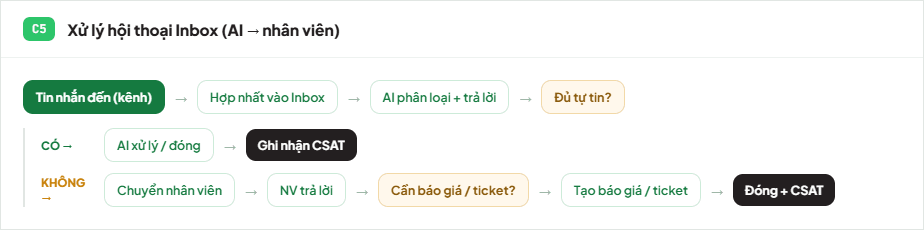

---

## D · Sơ đồ phân rã chức năng

### D1 — Bản đồ chức năng theo module
10 nhóm chức năng lõi và tính năng con.

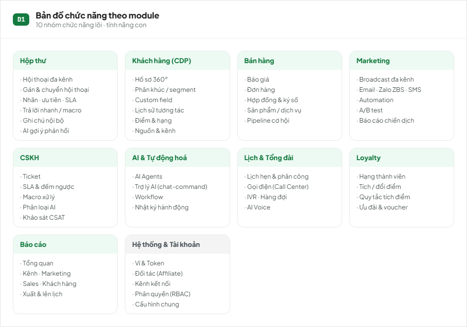

---

## E · Design System & Component Hierarchy

### E1 — Bản đồ Design System
Foundations → Components → Patterns.

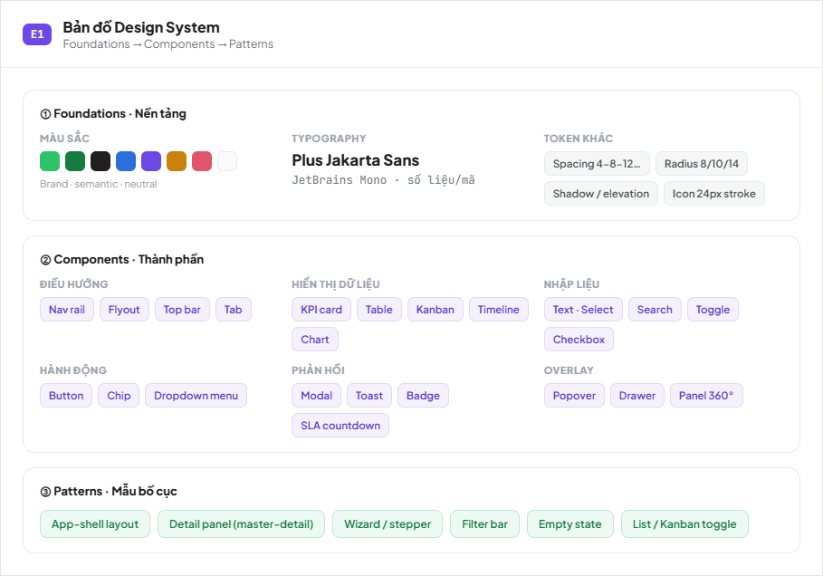

### E2 — Cây phân cấp component (App Shell)
Cấu trúc lồng nhau của giao diện Workspace.

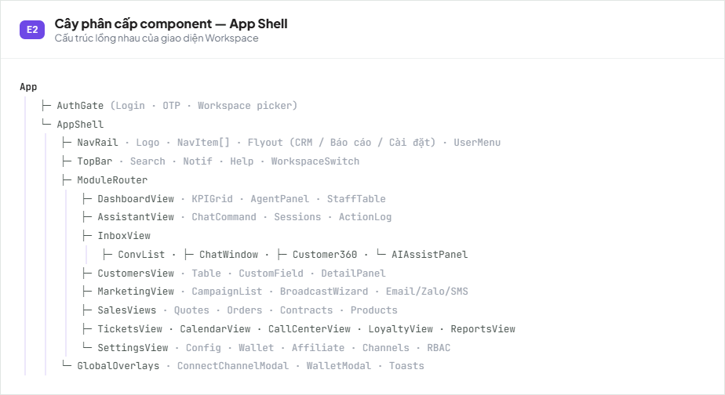

---

## F · Sequence Diagram

### F1 — Thanh toán & nạp ví qua QR (VietQR)
Nét liền = yêu cầu, nét đứt = phản hồi. Giao dịch được xác nhận qua webhook.

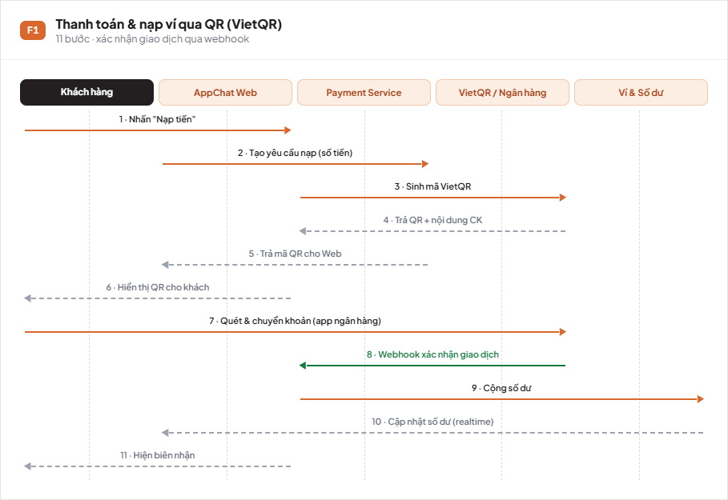

### F2 — Kết nối kênh qua OAuth + Webhook
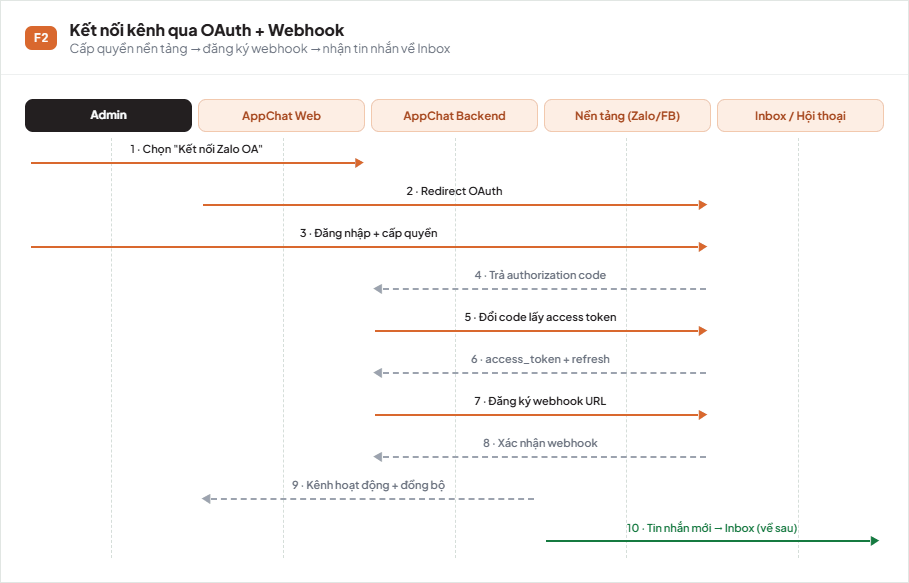

---

## G · Data Model & Luồng dữ liệu

### G1 — Mô hình thực thể (ER)
🔑 khoá chính · 🔗 khoá ngoại.

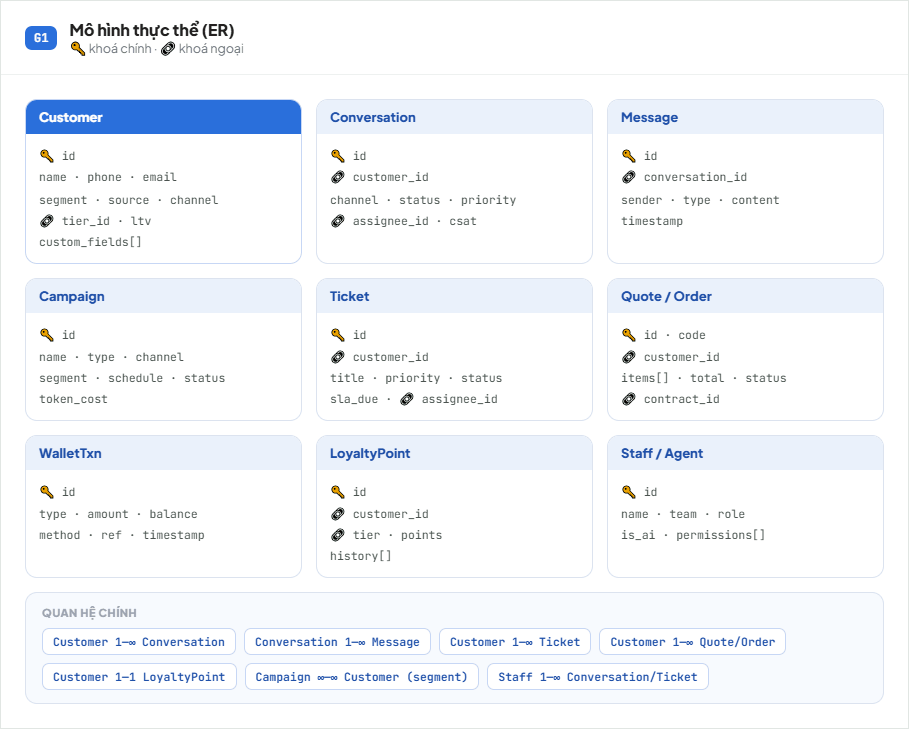

### G2 — Luồng dữ liệu omnichannel
Thu thập → chuẩn hoá → CDP → AI làm giàu → phân khúc → hành động → phân tích (có vòng phản hồi).

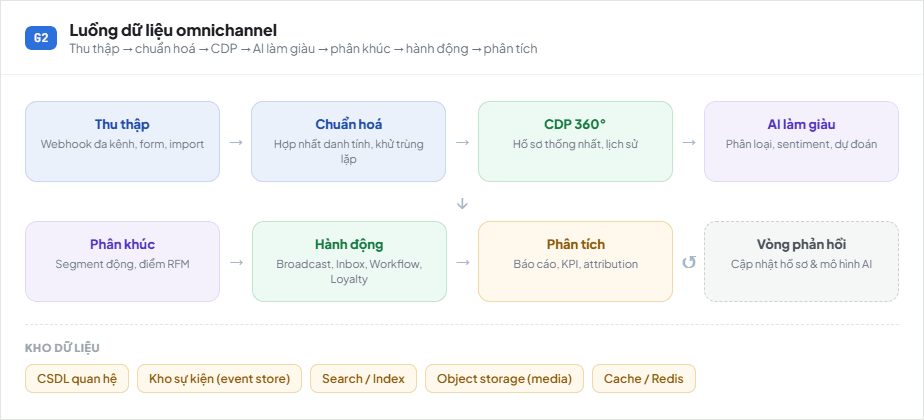

---

> Tạo bằng việc trực quan hoá SDD & sản phẩm AppChat. Cập nhật sơ đồ: chỉnh trong `UIUX-Architecture.dc.html` rồi xuất lại ảnh PNG.
